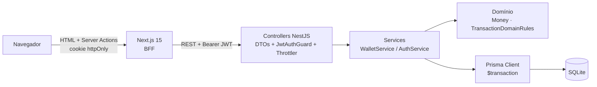
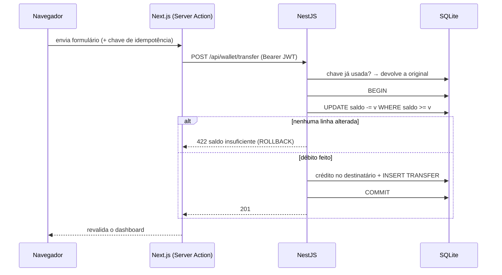
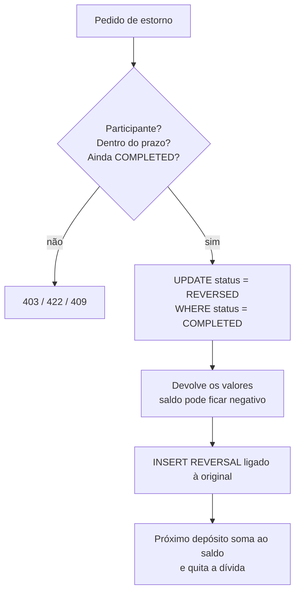
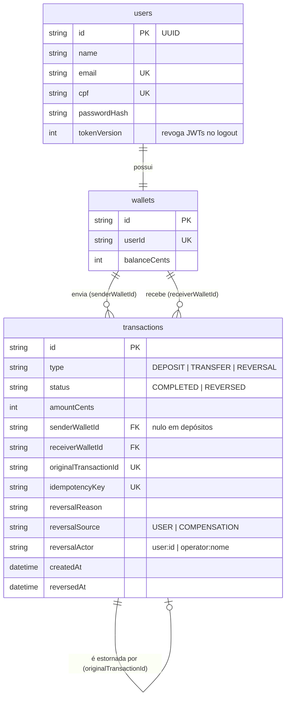

# Cobuccio Wallet — Node.js · NestJS · Next.js

Carteira financeira digital feita para o desafio técnico full stack do **Grupo Adriano Cobuccio**: cadastro, autenticação, depósitos, transferências entre usuários, extrato e estorno de operações.

O mesmo produto também foi implementado em **PHP/Laravel** (repositório `desafio-dev-php`). Os dois projetos seguem o mesmo contrato funcional: regras financeiras, limites operacionais e contas de demonstração equivalentes. Cada um mantém a própria arquitetura, os próprios mecanismos técnicos e a própria infraestrutura. A comparação completa está em [`docs/COMPARACAO_TECNICA.md`](docs/COMPARACAO_TECNICA.md).

**Diferenciais implementados:** valores em centavos inteiros, ledger imutável com estorno por contra-lançamento, idempotência de depósitos e transferências, proteção contra gasto duplo testada com processos Node independentes, compensação interna auditável, revogação do JWT no logout, limite de requisições e BFF com JWT em cookie `httpOnly`.

---

## 1. Visão geral

| Funcionalidade | O que faz |
| :--- | :--- |
| Cadastro | Cria o usuário e a carteira (saldo zero) numa única transação |
| Autenticação | Login com e-mail e senha; sessão por JWT guardado em cookie `httpOnly` |
| Dashboard | Saldo, totais, atalhos e últimas movimentações |
| Depósito | Credita a carteira; se o saldo estiver negativo, quita a dívida primeiro |
| Transferência | Envia dinheiro a outro usuário por e-mail ou CPF |
| Extrato | Histórico com filtros, situação de cada operação e prazos de estorno |
| Estorno | Reverte depósitos e transferências criando um lançamento `REVERSAL` |

---

## 2. Regras de negócio

> Regras e limites equivalentes aos do projeto PHP.

**Cadastro**
- Nome: 3 a 100 caracteres. E-mail: normalizado (sem espaços, minúsculo). CPF: exatamente 11 dígitos, gravado sem máscara (não há validação de dígito verificador em nenhuma das versões).
- Senha: 8 a 72 caracteres (72 é o limite que o bcrypt considera), gravada com hash bcrypt.
- E-mail e CPF únicos: duplicidade retorna **409**.

**Valores**
- Sempre em centavos inteiros (`R$ 10,50` → `1050`); nunca ponto flutuante.
- Por operação: mínimo R$ 0,01 e máximo **R$ 1.000.000,00**. O teto é uma decisão conservadora desta implementação, não um requisito do desafio, e fica centralizado em `Money.MAX_OPERATION_CENTS`.

**Depósito:** soma o valor ao saldo. Com saldo de −R$ 50,00, um depósito de R$ 100,00 deixa R$ 50,00 disponíveis.

**Transferência:** destinatário por e-mail ou CPF; não pode ser a própria carteira; exige saldo suficiente. Débito, crédito e registro acontecem numa única transação. Uma transferência nunca deixa o saldo negativo.

**Estorno**
- A operação original passa a `REVERSED` e é criado um lançamento `REVERSAL` ligado a ela (`originalTransactionId`, único). Nada é apagado.
- Um estorno não pode ser estornado, e a mesma operação não pode ser estornada duas vezes (**409**).
- O estorno pode deixar o saldo negativo, se quem recebeu já gastou o valor; o próximo depósito regulariza.

| Operação | Quem pode estornar | Prazo |
| :--- | :--- | :--- |
| Transferência | Remetente | 15 minutos |
| Transferência | Destinatário (devolução) | 24 horas |
| Depósito | Titular | 24 horas |

Os prazos são uma política desta aplicação, não do enunciado.

**Compensação por inconsistência técnica:** um estorno interno, sem as janelas de prazo do usuário, para corrigir erros técnicos (ex.: crédito duplicado encontrado numa conciliação). Não existe rota HTTP para isso: só o script `npm run wallet:compensate` (executado no servidor) chama a operação. Exige justificativa (mín. 10 caracteres) e responsável, grava `reversalSource = COMPENSATION` e `reversalActor = operator:<nome>` no lançamento `REVERSAL`, e não compensa duas vezes a mesma operação. O responsável é um identificador declarado na linha de comando e registrado para auditoria; ele não é uma identidade administrativa autenticada pelo sistema.

```bash
npm run wallet:compensate -- --transaction=<id> "--reason=Crédito duplicado na conciliação" --operator=<responsável>
# no container: docker exec cobuccio-wallet-api node dist/src/scripts/compensate.js --transaction=... "--reason=..." --operator=...
```

**Idempotência:** depósitos e transferências aceitam uma chave (`X-Idempotency-Key` ou campo `idempotencyKey`). Repetir a chave devolve a operação original sem mover dinheiro; reutilizá-la em outra operação — ou usar a chave de outro usuário — retorna **409**, sem expor a operação original.

**Limite de requisições:** login e cadastro, 10/min; operações da carteira, 30/min; demais rotas, 120/min. Acima disso, **429**.

**Códigos HTTP:** 201 criação · 200 consulta e estorno · 401 não autenticado/credencial inválida · 403 sem permissão · 404 inexistente · 409 conflito · 422 dado inválido ou regra violada · 429 limite.

---

## 3. Stack

| Camada | Tecnologia |
| :--- | :--- |
| Frontend / BFF | Next.js 15 (App Router, Server Actions), React 19, Tailwind CSS |
| API | NestJS 10, TypeScript, class-validator, Passport JWT, bcryptjs, @nestjs/throttler, Swagger |
| Dados | Prisma 6 + SQLite |
| Testes | Jest, Supertest |
| Infra | Docker Compose |

---

## 4. Arquitetura

O navegador só conversa com o Next.js. As páginas são Server Components e as mutações são Server Actions, que chamam a API NestJS do lado do servidor repassando o JWT no header `Authorization`.



| Pasta | Responsabilidade |
| :--- | :--- |
| `frontend/src/app` | Páginas (Server Components) |
| `frontend/src/actions` | Server Actions: validam, chamam a API, revalidam o dashboard |
| `backend/src/modules/*/dto` | Validação de entrada (class-validator) |
| `backend/src/modules/wallet/domain` | Regras puras, sem ORM: `Money`, `TransactionDomainRules` |
| `backend/src/modules/wallet/wallet.service.ts` | Transações, idempotência e escrita no ledger |

---

## 5. Fluxos principais

**Transferência**



**Estorno e recuperação de saldo negativo**



**Cadastro e login:** o cadastro valida o DTO, verifica duplicidade (409), grava usuário + carteira e devolve um JWT. O login compara o hash bcrypt e devolve um JWT; em ambos a Server Action grava o token no cookie.

---

## 6. Modelo de dados



Índices em `senderWalletId`, `receiverWalletId` e `createdAt` (consultas do extrato).

---

## 7. Autenticação e segurança

- **JWT:** emitido pela API (`JWT_SECRET`, expiração `JWT_EXPIRES_IN`), validado pelo `JwtStrategy`/`JwtAuthGuard`, que também confere se o usuário ainda existe.
- **Logout revoga o token:** cada usuário tem uma versão de sessão (`tokenVersion`) gravada no JWT (`ver`). O logout chama `POST /api/auth/logout`, que incrementa a versão; todo token emitido antes passa a receber **401**. Efeito colateral aceito: o logout encerra a sessão em todos os dispositivos.
- **BFF e cookie:** o Next.js é o BFF. Ele guarda o JWT num cookie `httpOnly` + `SameSite=Lax` (`Secure` quando `NODE_ENV=production`), então o token não fica disponível ao JavaScript do navegador. Do lado do servidor, as Server Actions leem o cookie e repassam o token à API.
- **CSRF:** JWT não protege contra CSRF por si só, porque aqui ele viaja num cookie. A mitigação vem da combinação de:
  - **mutações só por Server Actions** (POST);
  - **verificação nativa de origem do Next.js:** a Server Action é rejeitada quando o `Origin` não corresponde a `X-Forwarded-Host` (se presente) ou a `Host`. Requisições sem `Origin` geram só um aviso, e o projeto não configura `serverActions.allowedOrigins`;
  - **cookie `SameSite=Lax`**, que o navegador não envia em POSTs vindos de outros sites.
- **API NestJS:** recebe o JWT exclusivamente pelo header `Authorization: Bearer` e não lê cookies. Continua responsável por autenticar (`JwtAuthGuard`), autorizar (dono da carteira, participante do estorno) e validar os dados de cada operação. As proteções do Next.js não substituem essas verificações.
- **Dados pessoais:** a lista de contatos mostra o CPF mascarado (`***.666.777-**`); o CPF completo de outros usuários não sai da API.
- **Entrada:** `ValidationPipe` com `whitelist` e `forbidNonWhitelisted` (campos extras são rejeitados). Erros 500 não expõem detalhes ao cliente.
- **Autorização:** só o titular vê a própria carteira; estornar exige ser participante da operação.

---

## 8. Persistência e consistência

- **SQLite + Prisma Migrate.** Toda operação financeira roda em `prisma.$transaction`.
- **Gasto duplo:** o débito é um `UPDATE` condicional (`balanceCents >= valor`). SQLite não tem lock por linha — serializa as escritas no banco inteiro —, e o `UPDATE` condicional garante a regra mesmo assim.
- **Concorrência entre processos:** `test/concurrency` sobe **dois processos Node independentes** sobre o mesmo arquivo SQLite: duas transferências simultâneas (uma passa, a outra recebe 422), duas requisições com a mesma chave (um crédito, um replay) e uma falha no meio da transação (rollback completo).
- **`SQLITE_BUSY`:** o Prisma espera a trava do SQLite; se ainda assim vier `database is locked` ou conflito de escrita (P2034), a operação inteira foi desfeita e é repetida até 3 vezes com espera curta. Nos testes entre processos, nenhuma requisição terminou em erro de trava.
- **Estorno duplicado:** a mudança para `REVERSED` só acontece `WHERE status = COMPLETED`; um segundo pedido não altera nada e recebe 409.
- **Idempotência concorrente:** se duas requisições com a mesma chave passam juntas pela verificação, o índice único faz a segunda transação inteira ser desfeita, e ela devolve a operação da primeira.
- **Rollback:** testado com uma falha simulada depois do débito e do crédito; nenhum saldo muda.

---

## 9. Como executar

**Pré-requisitos:** Docker, ou Node.js 20+.

### Docker (recomendado)

```bash
docker compose up --build
```

Não precisa de `.env`. O backend aplica as migrations e o seed ao subir; o banco fica no volume `api_data` e sobrevive a `docker compose down`/`up` e a rebuilds.

| Serviço | URL |
| :--- | :--- |
| Aplicação | http://localhost:3000 |
| API | http://localhost:3333/api |
| Swagger | http://localhost:3333/api/docs |

O `JWT_SECRET` padrão do compose é só para uso local (`JWT_SECRET=... docker compose up --build` para trocar).

### Local

```bash
cd backend
cp .env.example .env        # defina JWT_SECRET
npm install
npx prisma migrate deploy
npm run db:seed
npm run start:dev           # http://localhost:3333
```

O seed só popula um banco **vazio** (não altera contas existentes).

```bash
cd frontend
cp .env.example .env.local
npm install
npm run dev                 # http://localhost:3000
```

---

## 10. Usuários de demonstração

Criados pelo seed (equivalentes aos do projeto PHP). Senha de todos: `password123`.

> Credenciais exclusivas para testes locais e demonstração. Não use estas contas nem esta senha em produção.

| Titular | E-mail | Saldo inicial | Cenário |
| :--- | :--- | :--- | :--- |
| Gabriel Cobuccio | `gabriel@cobuccio.com` | R$ 1.450,00 | Histórico de depósito e transferência |
| Bruno Costa | `bruno@cobuccio.com` | R$ 800,00 | Destinatário de transferências |
| Mariana Souza | `mariana@cobuccio.com` | −R$ 250,00 | Saldo negativo após estorno |

---

## 11. Testes

```bash
cd backend && npm test           # 31 testes unitários (domínio, DTOs, serviços)
cd backend && npm run test:e2e   # 23 testes: integração, paridade, compensação e concorrência entre processos
cd frontend && npm test          # 15 testes unitários (formatadores)
```

Resultado da última execução: **69 testes, todos passando**. Os testes e2e usam um banco próprio (`backend/test/e2e.db`, recriado a cada execução) e nunca o `dev.db`.

| Arquivo | Cobre | Equivalente no PHP |
| :--- | :--- | :--- |
| `test/parity.e2e-spec.ts` | Duplicidade, login inválido, valores inválidos, autotransferência, destinatário inexistente, chave reutilizada ou de outro usuário, rollback, regras de estorno, revogação do JWT e limite de requisições | `ParityScenariosTest`, `AuthTest` e `WalletOperationsTest` |
| `test/concurrency/multi-process.e2e-spec.ts` | Transferências e idempotência simultâneas e rollback, com dois processos Node independentes no mesmo arquivo SQLite | `tests/Concurrency/WalletConcurrencyTest` |
| `test/compensation.e2e-spec.ts` | Compensação técnica, inclusive a execução real do script | `tests/Feature/CompensationTest` |

---

## 12. Decisões técnicas

- **BFF com Next.js:** o token fica em cookie `httpOnly`, fora do alcance do JavaScript do navegador, e a API só aceita `Authorization: Bearer`. A mitigação de CSRF fica concentrada na camada que recebe cookies (Next.js); a API continua validando identidade, permissões e dados de cada operação.
- **Domínio sem ORM:** as regras financeiras são testadas sem banco.
- **`UPDATE` condicional em vez de lock pessimista:** o débito só acontece se o saldo atual for suficiente, sem depender de lock por linha. O comportamento de concorrência, isolamento e transações continua dependendo de cada banco; aqui ele foi validado com SQLite.
- **Chave de idempotência gerada no formulário:** um duplo clique ou nova tentativa reaproveita a chave; ela só muda depois de um sucesso.

---

## 13. Escopo e limitações conhecidas

**Fora do escopo**
- Gateway de pagamento, integração bancária e webhooks: o dinheiro é apenas um saldo interno.
- Interface administrativa: a compensação técnica só existe via CLI, para quem tem acesso ao servidor. O responsável informado é um identificador declarativo de auditoria, não um operador autenticado; não há gestão de operadores nem papéis administrativos.

**Limitações técnicas**
- O SQLite aceita um escritor por vez; para volume real, PostgreSQL (o schema Prisma troca de provider, mas a concorrência precisaria ser validada de novo).
- O limite de requisições fica em memória: reinicia com o processo e não é compartilhado entre instâncias.
- A concorrência foi testada com dois processos na mesma máquina; não houve teste de carga nem com vários servidores.
- O logout invalida os tokens anteriores pela `tokenVersion`, o que encerra as sessões do usuário em todos os dispositivos.
